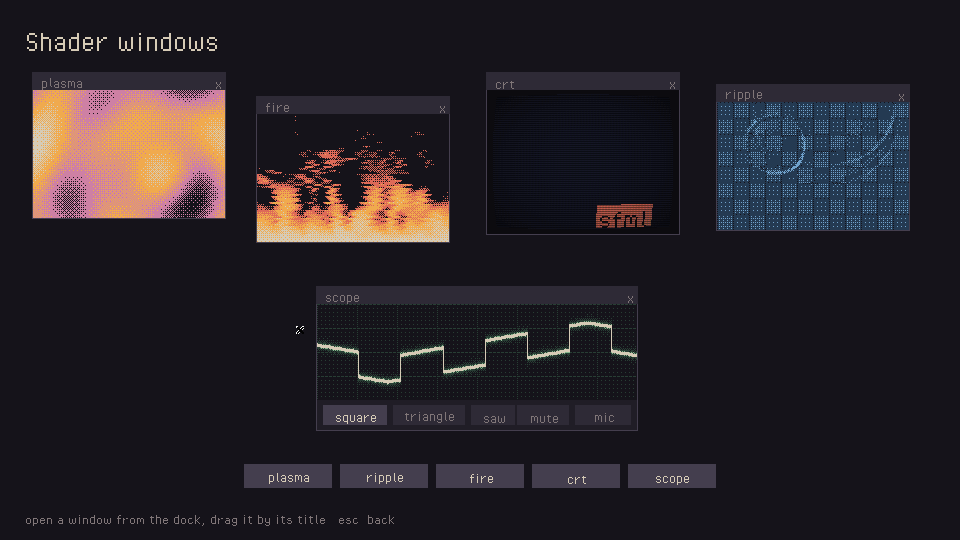
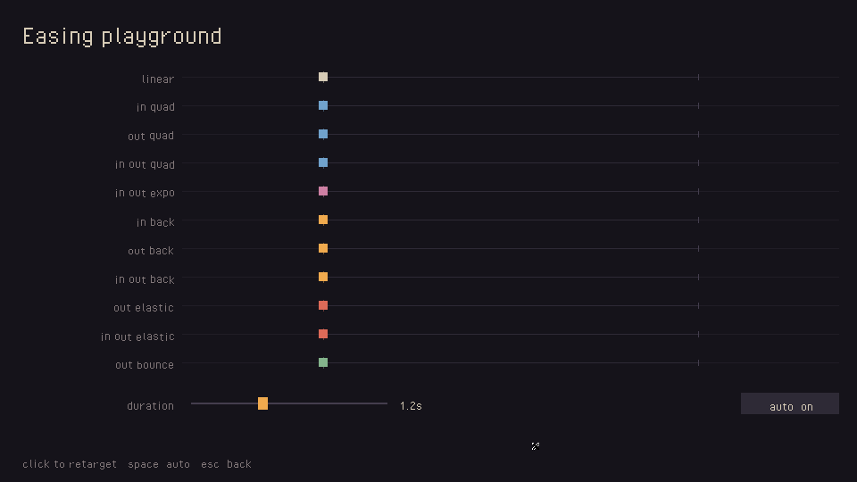
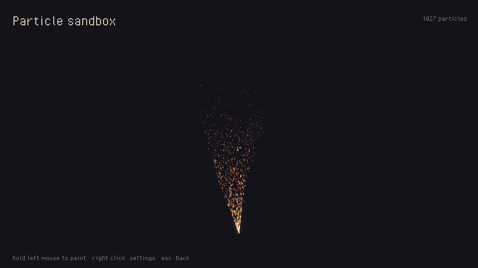
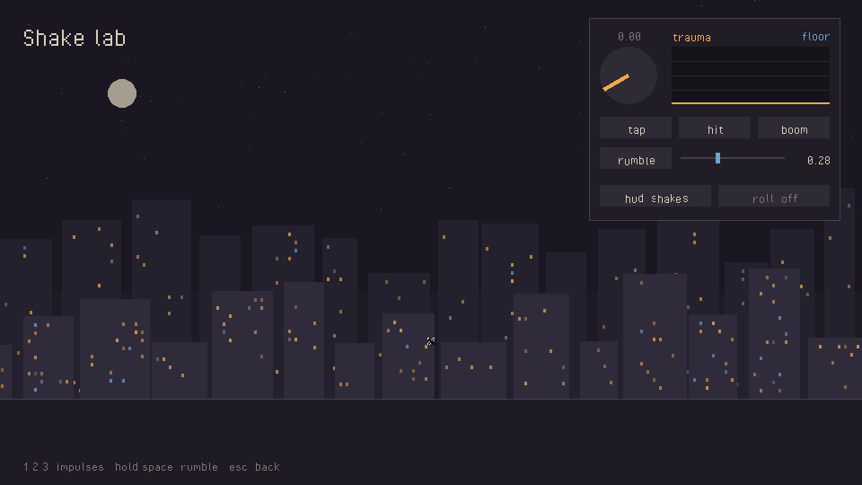
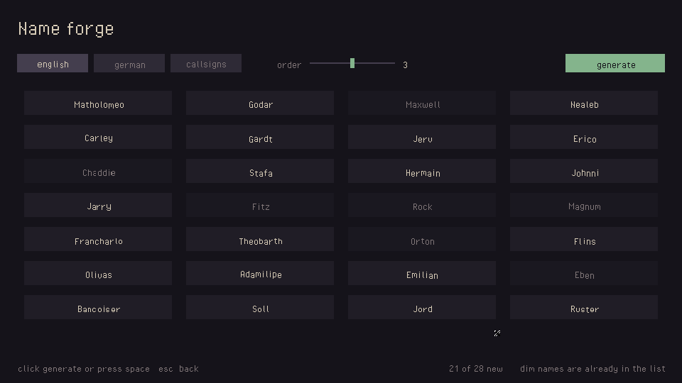
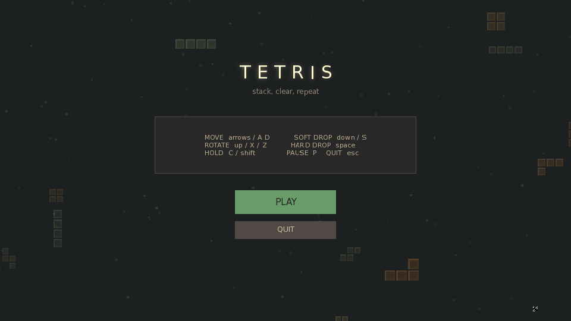

# sfml-framework

A small 2D game framework on top of SFML 3. It's the stuff I got tired of
rewriting for every game: scenes and transitions, a fixed timestep loop, UI
widgets, tweening, particles, camera shake, shaders and asset loading. You
write scenes, the framework handles the rest.

It's a spare-time project and it's still changing, but it's at the point
where you can build some really fun things with it.



## Trying it

You'll need SFML 3.0 and a C++20 compiler.

```
git clone https://github.com/heidelbergah/sfml-framework
cd sfml-framework
make EXAMPLE=showcase run
```

On macOS, `brew install sfml` and the Makefile finds Homebrew on its own.
On Windows (MSYS2/MinGW), point it at SFML with
`mingw32-make SFML_ROOT=C:/SFML-3.0.0`. More in [Building](#building).

## The showcase

`examples/showcase` is a menu with five small demos, each one there to show
off a different part of the framework. Number keys open them, escape goes
back.

| | |
|---|---|
|  |  |
| **Easing playground.** All eleven easing curves racing each other. Click anywhere to retarget them mid-flight and watch the back and elastic curves overshoot. | **Particle sandbox.** Hold the mouse to paint. Right click anywhere for a panel that tunes the emitter while it runs. |
|  |  |
| **Shake lab.** Impulses, a held rumble, and a live graph of the trauma behind them. You can also flip the HUD between shaking with the world and staying put. | **Name forge.** Markov chain names from English, German and callsign lists. Dim names already exist in the list, so you can see what the order slider actually does. |

The GIF at the top is the fifth one, **shader windows**. It's five draggable
windows, each running its own fragment shader: plasma, a rippling pool, a
CRT with three channels, fire, and an oscilloscope tracing a little
chiptune (or your mic, if you want). Only the window under the mouse reacts
to it.

There's also a proper Tetris clone with seven-bag, SRS wall
kicks, hold, T-spins and combos. It's the default example, so a plain
`make run` gets you that one.



## Your first scene

`SceneManager` owns the window and the game loop, and a `Scene` just
describes what happens on its screen. This is the whole of
`examples/hello`, a square that springs to wherever you click:

```cpp
#include "../../include/scenes/SceneManager.hpp"

class HelloScene : public Scene
{
    sf::RectangleShape         m_square{{24.0f, 24.0f}};
    Interpolated<sf::Vector2f> m_position{{480.0f, 270.0f}};

public:
    HelloScene()
    {
        m_square.setOrigin({12.0f, 12.0f});
        m_square.setFillColor(sf::Color(240, 170, 78));

        m_position.set_transition(TransitionFunction::EaseOutElastic);
        m_position.set_duration(0.8f);
    }

    void handle_event(const sf::Event& event, sf::Vector2f mouse) override
    {
        // Assigning starts a tween from wherever the square is right now.
        if(event.is<sf::Event::MouseButtonPressed>())
            m_position = mouse;
    }

    void render(sf::RenderTarget& target) override
    {
        m_square.setPosition(m_position);
        target.draw(m_square);
    }
};

int main()
{
    SceneManager scenes("hello");
    scenes.add_scene("hello", std::make_shared<HelloScene>());
    scenes.swap_scene("hello", SceneTransitionType::INSTANT);
    scenes.run(60);
}
```

```
make EXAMPLE=hello run
```

To start something of your own, copy that folder, rename it and build it
with `make EXAMPLE=<your folder>`.

## How it fits together

A few things that'll save you some time.

### Scenes

A scene overrides only what it needs:

```cpp
class GameScene : public Scene
{
    void on_enter() override;                                   // each time it becomes active
    void handle_event(const sf::Event& e, sf::Vector2f mouse) override;
    void update(sf::Time dt) override;                          // fixed step, scaled by GameTime
    void render(sf::RenderTarget& target) override;
    void begin_frame() override { m_widgets.begin_frame(); }    // clears "clicked this frame" flags
};
```

The mouse position you get is already mapped to the game's 960x540
resolution, however big the window is. Switch scenes from inside one with
`m_manager->request_scene_switch("menu", SceneTransitionType::FADE)`. The
switch happens between frames, so nothing gets swapped out from under its
own update.

### One clock for everything

```cpp
GameTime::pause();            // every tween, particle and camera move freezes
GameTime::set_scale(0.2f);    // slow motion
GameTime::resume();
```

`SceneManager` advances it once per fixed step. Anything that should keep
going while paused, like a pause menu, can opt out with `set_unscaled(true)`.

### Assign to a value and it tweens

```cpp
Interpolated<sf::Vector2f> pos;
pos.set_transition(TransitionFunction::EaseOutBack);
pos.set_duration(0.4f);

pos = {200.f, 100.f};          // starts the tween
sprite.setPosition(pos);       // converts to the current value
```

Retargeting mid-flight starts from wherever the value is at that moment,
so interrupting a tween never jumps. Widget positions are built on this
too, which is why everything in the showcase slides around for free.

### Camera shake that stacks

```cpp
m_camera.shake(0.2f);                         // a light hit
m_camera.shake(0.8f);                         // an explosion
if(firing) m_camera.set_sustained_shake(0.3f); // every frame something rumbles
```

Shake is "trauma" that builds up and decays, and the actual offset is
trauma squared, sampled from smooth noise. Hits add together instead of
replacing each other, and a held rumble gives you a steady floor that hits
spike above and settle back down to. Then you pick what each layer gets:

```cpp
target.setView(m_camera.get_view());        // world: pans and shakes
target.setView(m_camera.get_ui_view());     // HUD that shakes with it
target.setView(target.getDefaultView());    // HUD that stays still
```

### Assets

```cpp
const sf::Font* font = Assets::font("assets/fonts/default.ttf");
if(font) button->add_text("Play", *font, sf::Color::Black);
```

Fonts and textures load once and get shared. `Assets::font()` and
`Assets::texture()` also turn smoothing off, which matters more than you'd
think: SFML smooths fonts by default and small text turns to mush once the
frame is scaled up. Missing files come back as `nullptr` instead of
crashing.

### Widgets

`Button`, `TextBox`, `Slider`, `Gauge` and `Frame`, kept in a
`WidgetManager` that handles drawing order.

```cpp
auto play = std::make_shared<Button>(sf::Vector2f{96, 32}, sf::Color(46, 42, 54));
play->add_text("Play", *font, sf::Color::White);
play->set_callback([this]{ m_manager->request_scene_switch("game", SceneTransitionType::FADE); });
m_widgets.add_widget("play", play);
```

A `Frame` is a container with an optional title bar you can drag it by,
styled however you like:

```cpp
TaskbarStyle style;
style.color       = sf::Color(46, 42, 54);
style.text_color  = sf::Color(214, 203, 182);
style.close_color = style.color;
style.close_label = "x";
frame->add_taskbar(20.0f, "settings", style);
```

For overlapping windows, `widget_at(point)` gives you the front-most one
under the cursor and `bring_to_front()` raises it. That's all the shader
demo does to keep its windows separate.

### And the rest

- **Particles** are in world space, with speeds in units per second and
  angles in degrees (0 is right, 90 is up).
- **ShaderManager and BloomEffect.** Load a fragment shader by key, or
  switch on bloom with `enable_bloom()`.
- **EventBus** lets parts of a game talk without holding pointers to each
  other. Use `subscribe_scoped()` and the subscription cleans up after
  itself.
- **Markov** makes up names in the style of a word list.
- **Random** is one shared generator, so you can seed it for repeatable runs.

## Building

```
make                  # incremental, rebuilds when a header changes
make run
make debug            # -O0 -g with AddressSanitizer and UBSan
make release          # -O2 -DNDEBUG
make run-debug        # or run-release
make test             # framework tests, no window needed
make test-tetris      # Tetris' rule tests
make info             # platform, flags and the examples you can build
make clean
```

Everything takes `EXAMPLE=<folder>` to pick what to build. Binaries go in
`build/bin/`, and debug and release get their own `build/debug/` and
`build/release/`, so you can switch between them without cleaning.

| Platform | |
|---|---|
| Linux | Install the SFML 3 dev packages, or build SFML from source. |
| macOS | `brew install sfml`. Apple Silicon and Intel Homebrew are both found automatically. |
| Windows | MSYS2/MinGW with `mingw32-make SFML_ROOT=C:/SFML-3.0.0`. Add `WINDOWED=1` to a release build to drop the console window. |

## Layout

```
include/, src/
  core/         GameTime, Interpolated, Easing, AssetCache, Math, Random, Config
  framework/    Camera, EventBus, particles, ShaderManager, BloomEffect
  gui/          Widget, Button, TextBox, Slider, Gauge, Frame, WidgetManager
  scenes/       Scene, SceneManager
  utilities/    Markov
examples/
  hello/        the scene above
  showcase/     the five demos
  tetris/       Cascade
shaders/        bloom, plus the showcase's shaders
tests/          framework tests
```

## What's next

Roughly in the order I want to get to them:

- Sprites and animation: spritesheet slicing, frame timing, animation states
- Input mapping, so "jump" is an action and not `Key::Space`.
- Collision: AABB and circle tests, and a spatial hash once there are lots
  of things
- Tilemaps, with JSON save/load and **maybe** wave function collapse for
  generating them
- A sound and music manager (`Assets::sounds()` already caches buffers)
- Cutscenes, letterbox bars included
- Some kind of light entity setup once a game has more than a few types of
  thing

Known rough edges:

- `Frame` doesn't clip its children, so anything placed outside it draws
  outside it.
- Text centring in buttons goes by each string's own glyph bounds, so
  labels can sit a pixel or two differently depending on the letters.
- Particle gravity builds up over a particle's life instead of staying
  constant. It's a one-line fix, it just changes how existing effects feel.

## Credits

- [SFML](https://www.sfml-dev.org/) does all the actual heavy lifting.
- Pixel Operator by Jayvee Enaguas (CC0) is the showcase's font.
- DejaVu Sans is Tetris' font, under its own free license.

## License

MIT, see [LICENSE](LICENSE).
