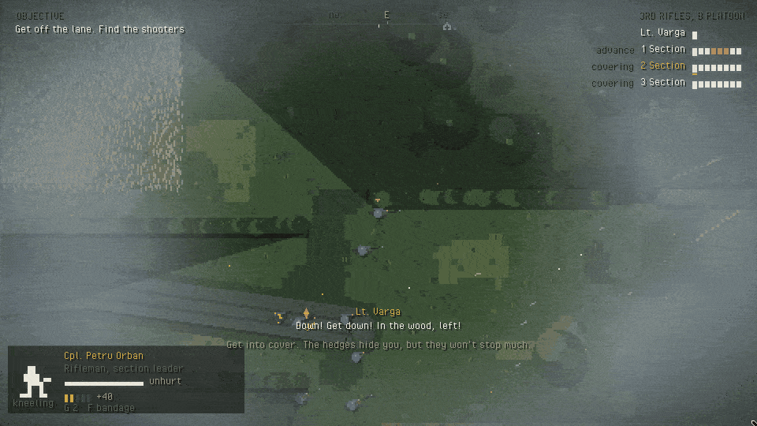
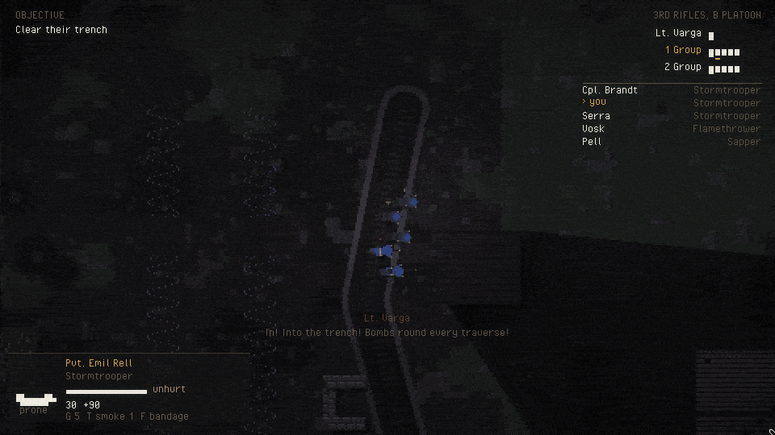
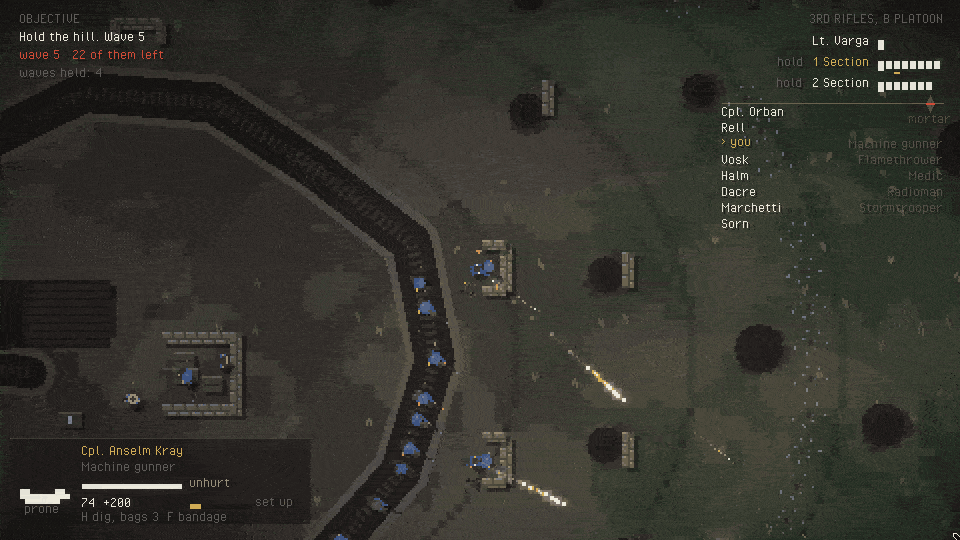

# Mud Cats: infantry demo

```
make EXAMPLE=mudcats run
```

A platoon's day, top-down. B Platoon of the Monteran 3rd Rifles, twenty-five
men in three sections and a lieutenant, against about forty Rechivii,
somewhere on the Ochre front in the spring of 1936. It's a slice of what combat in Mud
Cats could look like, built to see how the framework holds up with it.


## Where

You pick the place on the briefing screen. There are four.

**The Ochre line**, in the rain. It starts quietly behind the lines. You walk
up through the reserve trench, stop at the firing range to break some bottles
and get used to aiming, and join the others in the front trench. Then comes a
scout at the wire, our guns on their line, the whistle, and the assault:
across no man's land under a machine gun, into their trench, past a bunker
and into a farmhouse. After that you have to hold it, because they come back
for it.

**Halvek fields**, at dawn, in a mist. The platoon marches up a sunken lane
to hold a mill by a bridge, and nobody knows where the Rechivii are until
someone fires from a wood. Then it's hedgerow to hedgerow: tall grass and
wheat to crawl through, trees to hide under, a stream that's slow and cold
and has no cover at all, and the mill to take and keep. The mist burns off
as the morning goes on, so you see further, and so do they.



**The Dravo raid**, at night. A smaller one: the lieutenant and two
groups of stormtroopers, ten men, against a trench that's mostly asleep.
You crawl up the slope in the dark, lie still while the sappers cut two
lanes through their wire, slip into the trench and bomb both dugouts and
both machine guns at once. Then they know you're there. White flares go up
over the slope every few seconds, you clear the cottages and the barn,
put a satchel charge against the wall of their command dugout, and get
back across the slope to our ditch under their guns, before their reserve
arrives. If anyone sees you on the way in, the stealth is over early.



**Hill 312**, from the afternoon into the night. Sixteen of you dug in on a
hilltop: a ring of trench round the crest, gun pits, foxholes on the
forward slopes, a dump of ammunition and sandbags in the middle. They come
up it in waves, and it doesn't end until there's nobody left to hold it.

- **The waves.** Twenty-five men in the first, five more in each after
  that. Riflemen first, then
  machine guns that set up on the slope to keep your heads down, then
  snipers and mortars hanging back, then their own stormtroopers and
  flamethrowers. Later waves come from two or three sides at once, and the
  lieutenant turns the sections to meet each one.
- **The lulls.** You get 45 seconds to dig in before the first wave. After
  that, when the rush is down, whatever is left of the wave goes back where
  it came from, and you get ten seconds: enough to fill up at the dump and
  get back to the trench. Every third lull a few replacements walk up the
  back slope.
- **The light.** The afternoon goes, then the evening. By the seventh wave
  it's full dark, and white flares go up over whoever is coming.
- **The score.** The debrief tells you how many waves you held.
- **The music.** Once the first wave comes, the combat track is
  Misanthropy, and it doesn't let go in the lulls.



You also pick who you go in as and how hard it is. There are nine classes:
rifleman, officer, medic, flamethrower and machine gunner, plus these four:

- **Stormtrooper**: a submachine gun, a bag of grenades, and no patience.
- **Radioman**: carries the set. V calls a fire mission at the cursor: a
  ranging round first, then V again on target for a full salvo. B switches
  between high explosive and smoke. The guns don't care whose men are
  under them.
- **Sniper**: a scoped rifle that reaches much further than anything
  else, hard to spot lying down.
- **Sapper**: wire cutters (E at the wire) and two satchel charges (V),
  which go through walls close up.

The Rechivii have them too. There are snipers in their lines and in the
woods, flamethrowers in their trenches and the mill, stormtroopers in their
counter-attacks, and on the Ochre line, the fields and the hill, mortars.

Every class is playable on every level. Recruit, Regular or Veteran
change how well they shoot and how much a hit takes out of you. If your man dies you
take over the nearest one still standing, until there's nobody left.

## Controls

| | |
|---|---|
| WASD | move |
| Shift | run. Kneeling or lying down, it gets you up first |
| Mouse | aim |
| Left click | fire |
| Right click | hold to steady your aim and look further ahead. With a machine gun, sets it up |
| Middle click | bayonet. A rifle kills; anything else is a blow with the butt |
| C / Z | kneel / lie down |
| R | reload |
| G | grenade at the cursor |
| T | smoke grenade at the cursor |
| X | red flare: the guns put four shells round the cursor (officer only, and they're not precise) |
| V | radioman: call the guns on the cursor. Sapper: satchel charge |
| B | radioman: switch the next call between high explosive and smoke |
| H | the hill: dig in. Standing or kneeling, a row of sandbags in front of you (you carry three; refill at the dump). Lying down, a foxhole where you are |
| E | treat a wounded man if you're the medic (a prompt shows when you're close enough), drag him if you're not; cut wire if you're a sapper or stormtrooper; take a weapon or a dead man's rounds; fill up at an ammunition crate. When you're down, E calls for a medic |
| F | bandage yourself |
| Tab, 1 to 5 | orders, if you're leading: Tab picks a section (or all of them), then follow, hold, advance to the cursor, covering fire on the cursor, or fix bayonets and charge |
| Esc | pause, with all the keys |
| M | music on or off |

## What makes it tick

- **Sections, not men.** The lieutenant gives orders to sections, and each
  section's corporal finds his men cover around where they're sent. The
  sections leapfrog: one moves while the other two keep the enemy's heads
  down, then the next goes. Lose the corporal and the most senior man left
  takes over. Lose the lieutenant and the platoon looks to you.
- **Your section.** The men of your own section wear gold armbands, have a
  small gold mark over them, and are listed with their state in the corner.
  The sections move as groups around their corporals, and the next bound
  forward waits for you: nothing gets taken while you're somewhere else.
- **Mortars.** Theirs drop bombs on whatever their riflemen can see. The
  first lands well off, and each one after comes closer, so a man who stays
  put gets walked onto. Every bomb's flash gives the tube away, and a red
  mark shows where. As the radioman, put the cursor on the mark, even at the
  edge of the screen, and press V to call the guns on it. Your AI radioman
  does it himself.
- **Digging in.** Bags you fill are real cover: they stop rounds and block
  the way, for both sides. A foxhole is a shell hole you dug yourself.
- **The hill is a hill.** From higher up you see further, and climbing it is
  slow work.
- **Suppression.** Every round that passes close frightens whoever it passes,
  hit or miss. Frightened men aim worse, lie down and stop moving. You take a
  position the old way: pin it with fire and move someone else up while its
  head is down. That goes for both sides.
- **Cover is real.** Trenches, sandbags, low walls and shell holes stop
  rounds, more often the lower you are. Hedges hide you but mostly don't stop
  anything. Explosions only care about walls. Fire doesn't care about
  anything, and the stream puts it out.
- **Wounds, not hit points.** Men get wounded and keep going, lose arms and
  legs, go down and bleed out unless the medic reaches them in time, burn, or
  are killed outright. Wounded men crawl toward the medic, and a man with
  no medic near puts his own field dressing on a mate. Crosses at the edge
  of the screen show where your wounded are. A man who loses an arm drops
  his rifle. The dead, the
  blood and the craters stay on the field.
- **You only see what you can see.** Walls and hedges hide what's behind
  them, and enemies there aren't drawn. Nor are men lying in tall grass or
  under the trees until you're close, or anyone in smoke or past the edge of
  the mist. Muzzle flashes still give them away.
- **Weapons stay where they fall.** Out of ammunition, you can take a dead
  man's rounds, or his weapon. Men out of rounds ask the man next to them.
- **Men break.** With their officer dead and half of them gone, Rechivii
  start to run. Caught close with nowhere to go, some put their hands up.
  The debrief remembers what happened to them.

Every visible effect, from muzzle flashes and every round in the air to
blood, dust, flame, smoke screens and the rain, is the framework's particle
system. Rounds are hot streaks, tracers glow, and near misses kick dirt up
around you. At night the field is dark except for what's burning or under
a flare, and the flashes, flames and tracers light it up. Blood
and earth are thrown up into the air, and wherever each drop comes down it
stains the ground for good.

Everything is drawn from rectangles and circles, with no sprites. All the
sounds and both pieces of music come out of `tools/sfx/generate_mudcats.py`:
layered gunshots that roll away across the fields, a small formant
synthesiser for the voices, quiet music for the quiet parts and something
heavier and darker for the fighting. The one exception is the hill's
combat track, Misanthropy: `tools/sfx/make_hill_loop.py` cuts
`assets/music/misanthropy.mp3` down to one clean cycle, so it loops without
a seam, brings it up to level, and writes `assets/mudcats/music_hill_loop.ogg`.

## Files

| | |
|---|---|
| `Battle.cpp` | setup, input, the platoon and its sections, the levels' scripts |
| `Hill.cpp` | Hill 312's waves, digging in, and mortars |
| `Combat.cpp` | weapons, bullets, wounds, gore, grenades, satchels, smoke, flares, fire, shells, fire missions, the bayonet |
| `Effects.cpp` | everything drawn with the particle systems |
| `AI.cpp` | how everyone who isn't you decides what to do, and what they can see |
| `Render.cpp` | the field, the people, the HUD, the compass and markers |
| `Map.cpp` | the four battlefields' geometry, cover points, digging and A* paths |
| `Soldier.cpp` | the soldier data, the weapons, and how a man is drawn, from above and in profile |
| `Screens.cpp` | the briefing and the debrief |
| `Sound.cpp` | positional one-shots, loops, the two pieces of music |

## Switches for working on it

```
MUDCATS_STAGE=2 make EXAMPLE=mudcats run     # trenches: the barrage, just before the whistle
MUDCATS_STAGE=3 make EXAMPLE=mudcats run     # trenches: their trench already taken
MUDCATS_STAGE=4 make EXAMPLE=mudcats run     # trenches: in the farmhouse, waiting for the counter-attack
MUDCATS_AUTOPLAY=1 make EXAMPLE=mudcats run  # your man fights on his own (for recording)
MUDCATS_SPEED=3 make EXAMPLE=mudcats run     # three times faster
```

On the fields, `MUDCATS_STAGE` 1 to 3 starts at first contact, at the
stream, and in the mill. On the raid, 1 starts at their wire and 2 in their
trench with the alarm already up. On the hill, `MUDCATS_STAGE=N` starts just
before wave N.
