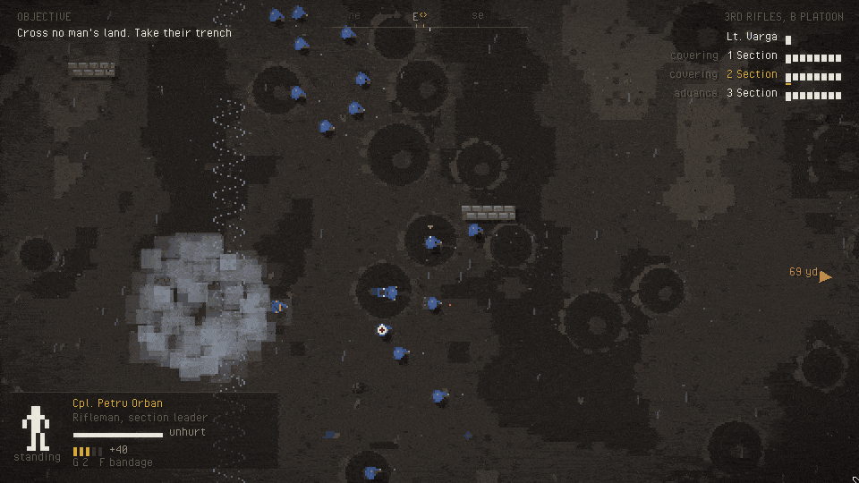

# Mud Cats: infantry demo

```
make EXAMPLE=mudcats run
```

One attack, top-down. Eight Monterans of the 3rd Rifles, 2 Section, against
sixteen Rechivii, somewhere on the Ochre front in the spring of 1936. It's a
slice of what combat in Mud Cats could look like, built to see how the
framework holds up with it.



## How it goes

You pick which of the eight men you go over as: rifleman, officer, medic,
flamethrower or machine gunner. It starts quietly behind the lines. You walk
up through the reserve trench, stop at the firing range to break some bottles
and get used to aiming, and join the others in the front trench. Then comes a
scout at the wire, our guns on their line, the whistle, and the assault:
across no man's land under a machine gun, into their trench, past a bunker
and into a farmhouse. After that you have to hold it, because they come back
for it.

If your man dies you take over the nearest one still standing, until there's
nobody left.

## Controls

| | |
|---|---|
| WASD | move |
| Shift | run |
| Mouse | aim |
| Left click | fire |
| Right click | steady your aim, or set the machine gun up |
| C / Z | crouch / go prone |
| R | reload |
| G | throw a grenade at the cursor |
| E | drag a downed man, or treat him if you're the medic. When you're down, E calls for a medic |
| F | bandage yourself |
| 1 2 3 4 | orders, if you're leading: follow, hold, advance to the cursor, covering fire on the cursor |
| Esc | pause |
| M | music on or off |

## What makes it tick

- **Suppression.** Every round that passes close frightens whoever it passes,
  hit or miss. Frightened men aim worse, lie down and stop moving. You take a
  position the old way: pin it with fire and move someone else up while its
  head is down. That goes for both sides.
- **Cover is real.** Trenches, sandbags and shell holes stop rounds, more
  often the lower you are. Standing right over a trench lets you see into it.
  Explosions only care about walls. Fire doesn't care about anything.
- **Wounds, not hit points.** Men get wounded and keep going, lose arms and
  legs, go down and bleed out unless the medic reaches them in time, burn, or
  are killed outright. The dead, the blood and the craters stay on the field.
- **You only see what you can see.** Walls hide what's behind them, and
  enemies there aren't drawn. Their muzzle flashes still are.
- **The officer matters.** Men near him get over their fear faster. When he
  falls, the section looks to you.

Everything is drawn from rectangles and circles, with no sprites. All the
sounds and both music layers, calm and combat, come out of
`tools/sfx/generate_mudcats.py`. The music fades between the two layers as
the fighting picks up and dies down.

## Files

| | |
|---|---|
| `Battle.cpp` | setup, input, the level script, the squad's orders |
| `Combat.cpp` | weapons, bullets, wounds, gore, grenades, fire, shells |
| `AI.cpp` | how everyone who isn't you decides what to do |
| `Render.cpp` | the field, the people, the effects, the HUD |
| `Map.cpp` | the battlefield's geometry, cover points and A* paths |
| `Soldier.cpp` | the soldier data and how a man is drawn |
| `Screens.cpp` | the briefing and the debrief |
| `Sound.cpp` | positional one-shots, loops, the two music layers |

## Switches for working on it

```
MUDCATS_STAGE=2 make EXAMPLE=mudcats run     # start at the barrage, just before the whistle
MUDCATS_STAGE=3 make EXAMPLE=mudcats run     # their trench already taken
MUDCATS_STAGE=4 make EXAMPLE=mudcats run     # in the farmhouse, waiting for the counter-attack
MUDCATS_AUTOPLAY=1 make EXAMPLE=mudcats run  # your man fights on his own (for recording)
MUDCATS_SPEED=3 make EXAMPLE=mudcats run     # three times faster
```
