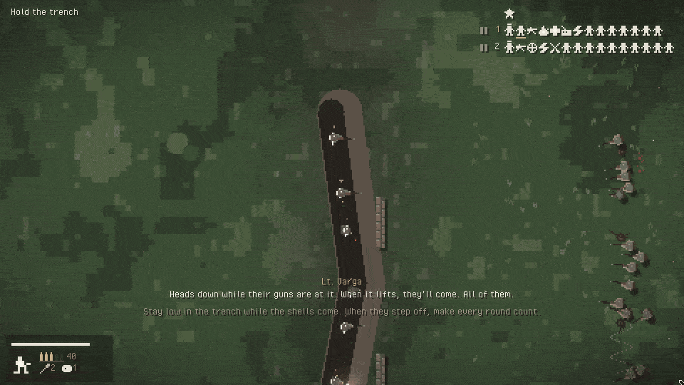
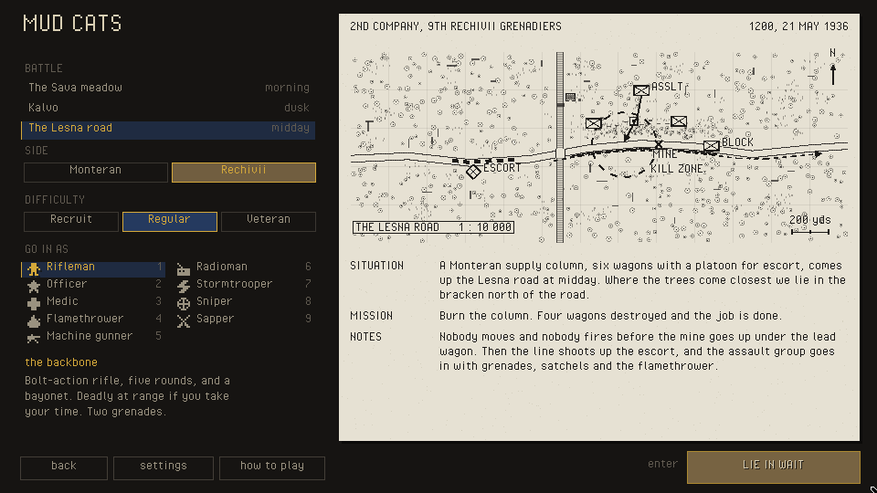
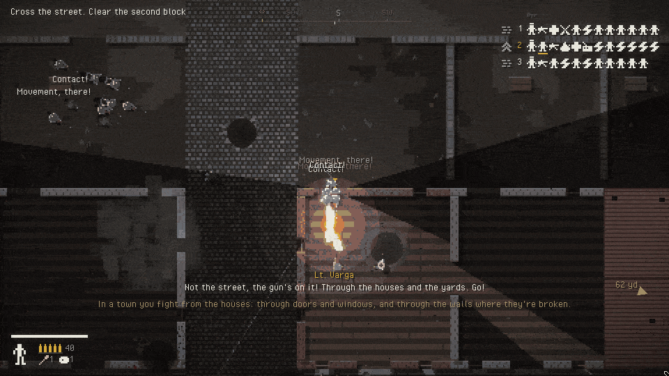
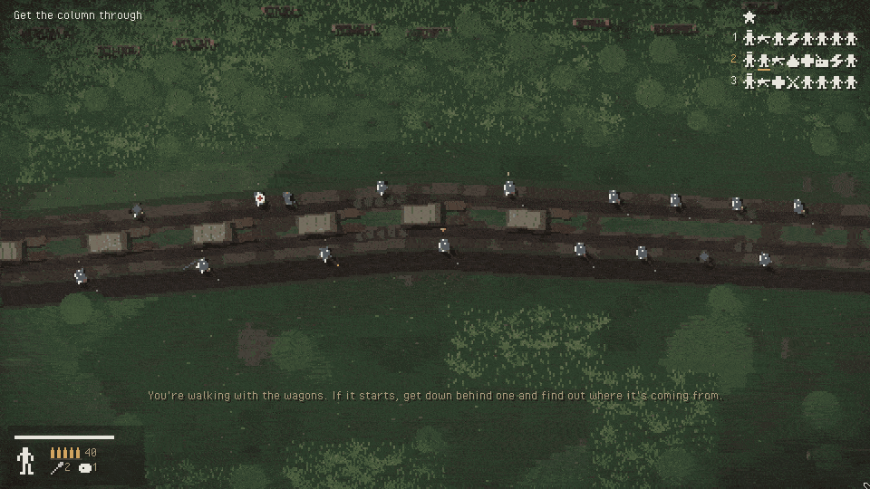

# Mud Cats: infantry demo

```
make EXAMPLE=mudcats run
```

A platoon's day, top-down, three times over. Somewhere on the Ochre front
in the spring of 1936, the Monterans and the Rechivii fight over a meadow,
a market town and a forest road, and you pick which side you're on, who
you go in as, and how hard it is. Then you're one man in it: the battle
goes on around you whatever you do, and you can turn it.

It's built on this framework, to see how the framework holds up with a
real game on it. Everything is drawn from rectangles and circles, and every
sound and nearly all the music is synthesised in code.



## Playing it

The title screen leads to the briefing. On the left you pick the battle,
the side, the difficulty, and who you go in as. On the right is the order
you'd be handed: a black-and-white staff map of the ground with the units
and the plan drawn on it, and the briefing under it. It's written for your
side, and the map only shows what your side knows. The escort's map has a
question mark in the trees where the ambush's map has the ambush.



The first time you play, a card explains how it works. It's under "how to
play" on the title and the briefing after that. Settings (sound levels,
window size, fullscreen) are there too, and F11 switches fullscreen
anywhere.

## The battles

**The Sava meadow**, on a grey morning. About a hundred and forty Rechivii
grenadiers in two lines at the edge of a wood, with their officers, a
colour-bearer and the drums, against thirty men of B Platoon in a shallow
trench at the other end of the meadow, with two machine guns and a line of
wire nobody finished. Their guns shell the trench while they form up, then
they walk out across the open, and when the front of the line is close
enough the whole field roars "Urraaa!" and runs the rest of the way with
the bayonet. Shoot the colour-bearer and someone picks the flag up, twice;
after that it stays down, and the men around it lose heart. The charge
breaks when they've lost too many, sooner without their officers or their
colours. If enough of them get into the trench and the Monterans are down
to a handful, the trench is overrun.

**Kalvo**, at dusk. A market town: a main street of terraced houses runs
east from the fields to a square, a cross-street cuts it in two, and at the
far end of the square is the church, its tower looking straight back down
the street. The Monterans take it block by block, through the houses and
yards because a machine gun behind a barricade covers the street, then the
square, then the church, and then hold the church against the
counter-attack that comes through the graveyard. The Rechivii fall back a
block at a time and win if the attack costs too much to go on, or hasn't
taken the church by dark. Nearly every fight here happens through a
doorway or a window.



**The Lesna road**, at midday. Six wagons of shells and rations going up to
the front through a forest, with B Platoon walking beside them. Thirty
Rechivii lie in the bracken north of the road where the trees come
closest, behind logs they've dragged up, with a machine gun among them and
riflemen behind a pine felled across the track further on. A mine under the
road is the signal, unless somebody in the column walks onto one of them
first. Once it's sprung the wagons stop where they are, and the only place
on the road to get out of the fire is the ditch along the south side. A
little later an assault group comes out of the trees for the wagons with
grenades, satchel charges and a flamethrower. Burn four of the six and the
ambush has done what it came for; lose too many men before that, and it
breaks and melts back into the forest.



## After the battle

The debrief puts what it cost on the left: how long the fighting lasted,
and for both sides how many men were killed, wounded, taken prisoner or
ran, out of how many went in (and on the Lesna road, how many wagons
burned). On the right is your own side's newspaper, in its next edition.
The Monteran Courier and the Voice of the Rechiv each report the battle
the way a paper at war would: a win is a triumph, a defeat is a gallant
stand or a shortened line, with your real numbers in the story and the
staff map of the ground beside it. From there you can fight it again, go
back to the briefing, or to the title.

## Your squad

You're one man in a section. Your section follows you; everyone else gets
on with it. The other sections find cover, bound forward, give covering
fire and fall back on their own, and go after the objective whatever you
do. On the Monteran side, if you're the officer your orders go to the
whole platoon (Tab picks a section), and if you're a corporal they go to
your own section.

If the lieutenant goes down, the most senior corporal takes over the
platoon, not you. If your corporal goes down, the next man takes over the
section, and if that's you, the section is yours to give orders to. If
your man dies you take over another from your section, and only when it's
gone, someone from another.

There are nine classes, and every one is playable in every battle, on
either side:

- **Rifleman**: a bolt-action rifle, five rounds, a bayonet, two grenades.
- **Officer**: a submachine gun, orders, smoke to cover a bound, and red
  flares to bring down the guns.
- **Medic**: a pistol and eight field dressings. Only he gets a man who is
  down back on his feet. Wounded men crawl to him.
- **Flamethrower**: burns through any cover, up close. Slow, short of fuel,
  shot at first, and his tanks can burst.
- **Machine gunner**: has to set up to fire, and pins a whole section with
  one burst.
- **Radioman**: the set reaches the guns. V calls a fire mission at the
  cursor: a ranging round first, then V again on target for a salvo. B
  switches between high explosive and smoke.
- **Stormtrooper**: a submachine gun, a bag of grenades, and no patience.
- **Sniper**: a scoped rifle that reaches much further than anything else,
  and hard to spot lying down.
- **Sapper**: wire cutters (E at the wire) and two satchel charges (V),
  which go through walls, or a wagon.

Recruit, Regular and Veteran change how well the other side shoots and how
much a hit takes out of you.

## Controls

| | |
|---|---|
| WASD | move |
| Shift | run. Kneeling or lying down, it gets you up first |
| Mouse | aim |
| Left click | fire |
| Right click | hold to steady your aim and look further ahead. With a machine gun, sets it up |
| Middle click | bayonet. A rifle kills; anything else is a blow with the butt |
| C / Z | kneel / lie down |
| R | reload |
| G | grenade at the cursor |
| T | smoke grenade at the cursor |
| X | red flare: the guns put four shells round the cursor (officer only, and they're not precise) |
| V | radioman: call the guns on the cursor. Sapper: satchel charge |
| B | radioman: switch the next call between high explosive and smoke |
| E | treat a wounded man if you're the medic, drag him if you're not; cut wire; take a weapon or a dead man's rounds; fill up at an ammunition crate. When you're down, E calls for a medic |
| F | bandage yourself |
| Tab, 1 to 5 | orders, if you lead: Tab picks a section (officer only), then follow, hold, advance to the cursor, covering fire on the cursor, or fix bayonets and charge |
| Esc | pause: the sound levels and all the keys |
| M | music on or off |
| F11 | fullscreen |

## What makes it tick

- **Sections, not men.** Orders go to sections, and each section's
  corporal finds his men cover around where they're sent. The sections
  leapfrog: one moves while the others keep the enemy's heads down, then
  the next goes.
- **Suppression.** Every round that passes close frightens whoever it
  passes, hit or miss. Frightened men aim worse, lie down and stop moving.
  You take a position the old way: pin it with fire and move someone else
  up while its head is down. That goes for both sides.
- **Cover is real.** Trenches, ditches, sandbags, low walls, logs, wagons
  and shell holes stop rounds, more often the lower you are. Hedges and
  bracken hide you but mostly don't stop anything. Trees stop what hits
  the trunk. Explosions only care about walls. Fire doesn't care about
  anything.
- **Wounds, not hit points.** Men get wounded and keep going, lose arms
  and legs, go down and bleed out unless the medic reaches them in time,
  burn, or are killed outright. Wounded men crawl toward the medic.
  Crosses at the edge of the screen show where your wounded are. The dead,
  the blood and the craters stay on the field.
- **You only see what you can see.** Walls and hedges hide what's behind
  them, and enemies there aren't drawn. Nor are men lying in tall grass or
  bracken until you're close, or anyone in smoke. Muzzle flashes still
  give them away. Men lying still in ambush are very hard to see at all.
- **Seeing into buildings.** From a distance a roof hides everything under
  it. Get close and it opens up, and you see inside as far as your line of
  sight reaches through the door and the windows.
- **Hearing what you can't see.** A shot, a shout, or a man running close
  by leaves a pale ring where the sound came from, roughly.
- **Weapons stay where they fall.** Out of ammunition, you can take a dead
  man's rounds, or his weapon.
- **Men break.** With their officer dead and half of them gone, men start
  to run. Caught close with nowhere to go, some put their hands up. The
  debrief counts them.

## The HUD

- **Top right, the platoon.** One row per section, one small picture per
  man showing his role. Its colour is how he is: white for fine, amber for
  hurt, grey for pinned, orange for burning, red for down, a man lying flat
  for dead. A bar over a man marks the corporal, gold under him marks you,
  and the picture left of each row shows what that section was last told
  to do.
- **Bottom left, you.** Your health, a picture of how you're standing, and
  what's in your gun, drawn the way that gun holds it. Under it, what else
  you carry.
- **Bottom right, orders**, when they're yours to give.

## The sound

The voices come from a small formant synthesiser: men's voices, low and
rough. Each take of a cry belongs to one of a handful of men, from a deep
voice with a big chest to a lighter one, and every soldier also gets his
own pitch, a little above or below the next man's, so a section sounds
like several men and the same man sounds like himself all day. When a lot
of men are screaming at once you hear the loudest few, and each voice
already playing makes the next a little quieter, so a crowd sounds bigger
rather than louder.

Music plays on the title and in the fighting, and nowhere else: the
briefing, the debrief and the quiet before a battle have only their own
sounds. Each battle has its own combat track. On the meadow it's war
drums and brass, with the Rechivii drums across the field kept in time
with it. In Kalvo, low strings and a tolling bell. On the Lesna road,
something that lands like an ambush: it cuts in at once on a brass
stinger, then a distorted bass hammers away under war drums, diminished
brass stabs and a horn line climbing like an alarm. All of it comes out
of `tools/sfx/generate_mudcats.py`.

Your settings are kept in `settings.txt`: in `%APPDATA%\MudCats` on
Windows, `~/Library/Application Support/MudCats` on macOS, and
`~/.config/mudcats` on Linux.

## The words

Every word the game shows or says is in one file,
`assets/mudcats/text/en.json`: the menus, the briefings, the HUD, what the
officers say and what men shout, the soldiers' names, the newspapers.
Change a line there and run the game again; nothing needs rebuilding. Each
line is found by its path through the file, like
`levels.town.won.monteran`. Where there's a list (the headlines, or the
shouts when a man is hit) one is picked at random, so a list can be made
longer. Words in braces, like `{minutes}`, are filled in by the game.

If a line goes missing the game shows its key in brackets instead of
crashing, and `python3 tools/text/check_text.py` lists every key the code
asks for that the file doesn't have. Running the game with
`MUDCATS_TEXT_CHECK=1` reports each missing key once as it comes up.

## Building it for Linux, macOS and Windows

The Makefile is the quick way on Linux, and works on macOS (Homebrew SFML)
and on Windows under MSYS2. To build something you can hand to someone
else, use CMake: it downloads SFML 3 and links it in statically, so the
result runs on a machine with nothing installed.

```
cmake -B build-cmake -DCMAKE_BUILD_TYPE=Release
cmake --build build-cmake --config Release
cmake --build build-cmake --config Release --target package
```

The last line makes `MudCats-0.14.0-<system>.zip`: the game with its
assets, shaders, this README and the licence. On Windows that's
`MudCats.exe` with its icon and no console window; on macOS, `Mud Cats.app`;
on Linux, `MudCats`. The game finds its assets next to itself, so it can be
started from anywhere. On Linux, CMake needs SFML's usual development
packages first; on Debian or Ubuntu that's `libx11-dev libxrandr-dev
libxcursor-dev libxi-dev libudev-dev libgl1-mesa-dev libfreetype-dev`.

macOS will warn about an app from an unidentified developer, since it
isn't signed: right click, Open, the first time.

## Files

| | |
|---|---|
| `main.cpp` | finds the assets, sets up the window from your settings, and the scenes |
| `Screens.cpp` | the title, the briefing with its staff maps, the settings, how to play and credits panels, the debrief and its newspaper |
| `Text.cpp` | reads `assets/mudcats/text/en.json`, and looks lines up in it |
| `Settings.cpp` | your sound levels, window size and fullscreen, kept between runs |
| `Battle.cpp` | setup, input, the platoon and its sections, the stages of each battle |
| `Charge.cpp` | the Sava meadow: the two lines, the charge, the colours, and how it breaks |
| `Town.cpp` | Kalvo: the defence in depth, falling back, reinforcements, and how the attack breaks |
| `Forest.cpp` | the Lesna road: the column, the wagons, the mine, the ambush and the assault group |
| `Mortar.cpp` | mortars and their crews |
| `Combat.cpp` | weapons, bullets, wounds, gore, grenades, satchels, smoke, flares, fire, shells, fire missions, the bayonet |
| `Effects.cpp` | everything drawn with the particle systems |
| `AI.cpp` | how everyone who isn't you decides what to do, and what they can see |
| `Render.cpp` | the field, the people, the HUD, the compass and markers |
| `Icons.hpp` | the HUD's little pictures: roles, orders, kit |
| `Map.cpp` | the meadow's geometry, cover points and A* paths |
| `MapTown.cpp`, `MapForest.cpp` | Kalvo's and the Lesna road's ground, and how it's drawn |
| `Soldier.cpp` | the soldier data, the weapons, and how a man is drawn |
| `Sound.cpp` | positional one-shots, loops, the music and its combat tracks, how voices are mixed |

## Switches for working on it

```
MUDCATS_AUTOPLAY=1 make EXAMPLE=mudcats run  # your man fights on his own (for recording)
MUDCATS_SPEED=3 make EXAMPLE=mudcats run     # three times faster
MUDCATS_STAGE=1 make EXAMPLE=mudcats run     # start part way in
```

On the meadow, `MUDCATS_STAGE` 1 starts as the lines step off and 2 just
as they break into the run. In Kalvo, 1 starts at the cross-street, 2 at
the edge of the square and 3 in the church with the counter-attack coming.
On the Lesna road, 1 starts with the column a few seconds short of the
mine, and 2 right on it.

There's room for 256 men on a field, which the meadow uses most of.
